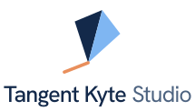

 

<picture>
  <source media="(prefers-color-scheme: dark)" srcset="./assets/tangent-kyte-logo-stacked-white.svg">
  
</picture>

 
 

### Software, built by one team.

We design, build and run web, mobile, AI and cloud software. 
One team, one repository, and the code is yours from day one.

 

&nbsp;

&nbsp;

&nbsp;

 

## What we build

<table>
  <tr>
    <td valign="top" width="33%">
      <h4>Product</h4>
      Frontend 
      Backend 
      Databases 
      Full-stack projects 
      Mobile apps 
      Desktop apps 
      APIs and integrations 
      Real-time and networking 
      Browser extensions
    </td>
    <td valign="top" width="33%">
      <h4>AI and data</h4>
      AI-powered apps 
      Machine learning (MLOps) 
      Web scraping and data pipelines
      <h4>Quality and security</h4>
      Code quality and testing 
      Security and authentication 
      Performance optimization
    </td>
    <td valign="top" width="33%">
      <h4>Cloud and architecture</h4>
      DevOps and deployment 
      Cloud: AWS, GCP, Azure 
      System design 
      Microservices
      <h4>Specialist builds</h4>
      Tooling and automation 
      Bots: Discord, Telegram, WhatsApp, Slack 
      Game development 
      Blockchain and Web3 
      Embedded systems and IoT
    </td>
  </tr>
  <tr>
    <td colspan="3">
      <b>Design and growth</b>&nbsp;&nbsp;·&nbsp;&nbsp;UI/UX design and prototyping&nbsp;&nbsp;·&nbsp;&nbsp;Open-source contributions&nbsp;&nbsp;·&nbsp;&nbsp;Documentation and technical writing&nbsp;&nbsp;·&nbsp;&nbsp;Portfolio and career
    </td>
  </tr>
</table>

## How we work

| | Step | What happens |
| :---: | --- | --- |
| **1** | **Plan** | A free call, then a written plan with scope, timeline and price. |
| **2** | **Build** | Short sprints with a demo every week. You see progress, not reports. |
| **3** | **Ship** | Tested, reviewed and deployed automatically, with monitoring on. |
| **4** | **Support** | Updates, fixes and new features after launch. |

## Ways to work with us

| Sprint | Dedicated team | Support |
| --- | --- | --- |
| Fixed price, 2 to 6 weeks | Monthly, most popular | Monthly, after launch |
| One clear job: an MVP, a bot, an audit or a speed fix. | A lead plus the specialists you need, for products that keep growing. | Updates, fixes and small features for software already in use. |

## Tools we work with

  
   
  

## Principles

- **One team, no hand-offs.** Design, engineering and operations work in one repository with one history.
- **Your code, from the first commit.** Everything lives in your accounts, never ours.
- **Show, don't report.** Working software every week, not slide decks.
- **Built to last.** Tests, reviews and monitoring come as standard, not as extras.

 

### Tell us what you're building.

Send a few lines about your project. We reply within one business day.

**[hello@tangentkyte.studio](mailto:hello@tangentkyte.studio)**

 

Precise engineering. Ideas that fly.

